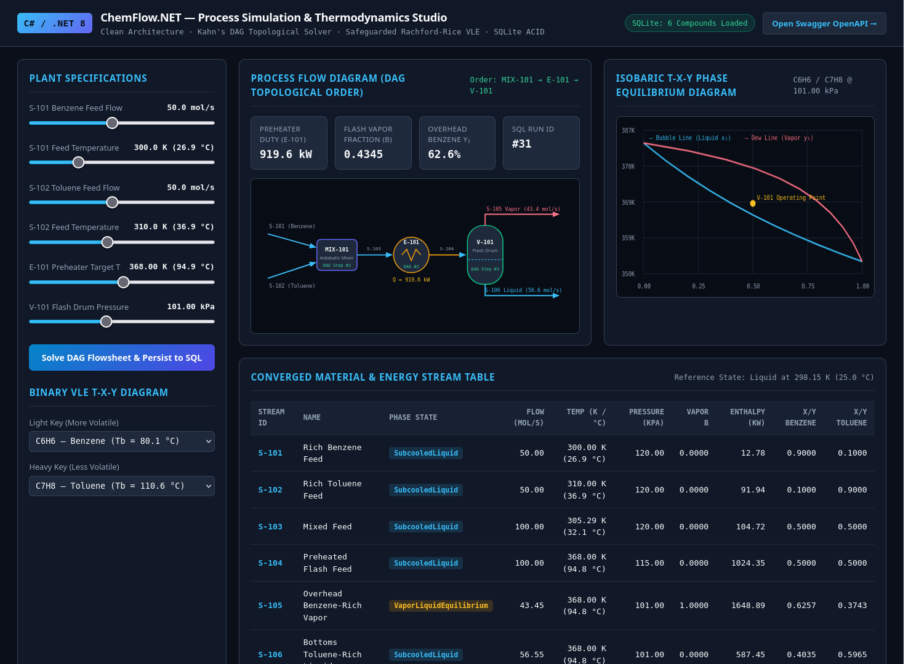

# ChemFlow.NET

[](https://github.com/yancsalmeida/ChemFlow.NET/actions/workflows/ci.yml)
[](https://dotnet.microsoft.com/)
[](docker-compose.yml)
[](LICENSE)

**Modular Steady-State Chemical Process & Thermodynamic Simulation Engine in C# / .NET 8**

`ChemFlow.NET` is a domain-driven process simulation engine built with **C# 12** and **.NET 8** following **Clean Architecture** principles. It models vapor-liquid equilibrium (VLE), mass and enthalpy balances, unit operations, and directed acyclic graph (DAG) process flowsheets with relational persistence in **SQLite**.



---

## Architecture & Project Structure

```text
ChemFlow.NET/
├── src/
│   ├── ChemFlow.Domain/           # Pure domain models, thermodynamics, unit operations & DAG flowsheet engine
│   ├── ChemFlow.Infrastructure/   # Relational SQLite persistence (ADO.NET / Microsoft.Data.Sqlite)
│   └── ChemFlow.Api/              # ASP.NET Core Minimal API endpoints & OpenAPI/Swagger
└── tests/
    └── ChemFlow.Tests/            # Automated unit & integration test suite (xUnit)
```

### 1. Thermodynamic Engine (`ChemFlow.Domain.Thermodynamics`)
- **Antoine Vapor Pressure Model:** Saturation pressure $P_i^{\text{sat}}(T)$ and boiling temperature inversion using validated NIST/DIPPR-style coefficients.
- **Vapor-Liquid Equilibrium (Raoult's Law):** Equilibrium $K$-values ($K_i = P_i^{\text{sat}}(T)/P$), Bubble Point ($P_{\text{bubble}}, T_{\text{bubble}}$), and Dew Point ($P_{\text{dew}}, T_{\text{dew}}$) solvers.
- **Rachford-Rice Isothermal Flash (`RachfordRiceSolver`):** Safeguarded Newton-Raphson + bisection root-finding solver for the Rachford-Rice objective function:
  $$f(\beta) = \sum_{i=1}^{N} \frac{z_i (K_i - 1)}{1 + \beta (K_i - 1)} = 0$$
- **Calorimetry & Enthalpy:** Sensible liquid/vapor heat capacities and latent heat of vaporization ($\Delta H_{\text{vap}}$) referenced to $T_{\text{ref}} = 298.15\text{ K}$.

### 2. Unit Operations & Flowsheet Graph (`ChemFlow.Domain.Units` & `Flowsheet`)
- **`MaterialStream`:** Tracks molar flow rate, temperature, pressure, component mole fractions, phase state (`Liquid`, `Vapor`, `TwoPhase`), vapor fraction $\beta$, and specific/total enthalpy.
- **`Mixer`:** Adiabatic multi-stream mixing with rigorous component mass conservation and enthalpy balance root-finding for outlet temperature.
- **`HeaterCooler`:** Sensible and phase-change thermal duty ($\dot{Q}$ in $\text{kW}$) calculation to reach a specified target temperature and pressure.
- **`FlashDrum`:** Isothermal/isobaric vapor-liquid separator splitting a feed into equilibrium overhead vapor and bottoms liquid streams.
- **`ConversionReactor`:** Stoichiometric reactor with limiting-reactant validation, fractional conversion, and heat of reaction ($\Delta H_{\text{rxn}}^\circ$) energy balance.
- **`ProcessFlowsheet`:** Models the plant as a Directed Acyclic Graph (DAG) and resolves execution order automatically via **Kahn's Topological Sort Algorithm** ($O(V + E)$), detecting and rejecting recycle loops before execution.

### 3. Relational Persistence & REST API (`ChemFlow.Infrastructure` & `ChemFlow.Api`)
- Raw SQL persistence using `Microsoft.Data.Sqlite` (`ADO.NET`) with parameterized queries, foreign-key constraints, and transactional batch inserts (`SaveSimulationRun`).
- **ASP.NET Core Minimal API Endpoints:**
  - `GET /api/compounds` & `GET /api/compounds/{id}` — Query pure-component physical and Antoine parameters from SQLite.
  - `POST /api/thermo/flash` — Solve an isothermal $(T, P)$ Rachford-Rice flash for a multicomponent mixture.
  - `POST /api/thermo/txy` — Generate binary $T\text{-}x\text{-}y$ phase equilibrium curves.
  - `POST /api/simulations/benchmark` — Execute and persist the Benzene-Toluene flash separation flowsheet (`Mixer` $\rightarrow$ `HeaterCooler` $\rightarrow$ `FlashDrum`).
  - `GET /api/simulations` & `GET /api/simulations/{id}` — Retrieve persisted simulation runs and stream states.

---

## Getting Started

### Option 1: Run with Docker Compose (Recommended)

Requires only [Docker](https://docs.docker.com/get-docker/):

```bash
docker compose up --build
```

- **Interactive Web Studio:** [http://localhost:5080](http://localhost:5080)
- **OpenAPI / Swagger UI:** [http://localhost:5080/swagger](http://localhost:5080/swagger)

### Option 2: Run with Native .NET SDK

Requires [.NET 8.0 SDK](https://dotnet.microsoft.com/download/dotnet/8.0):

```bash
# Build solution
dotnet build ChemFlow.sln

# Run all 21 unit & integration tests
dotnet test ChemFlow.sln

# Run API server
dotnet run --project src/ChemFlow.Api
```
