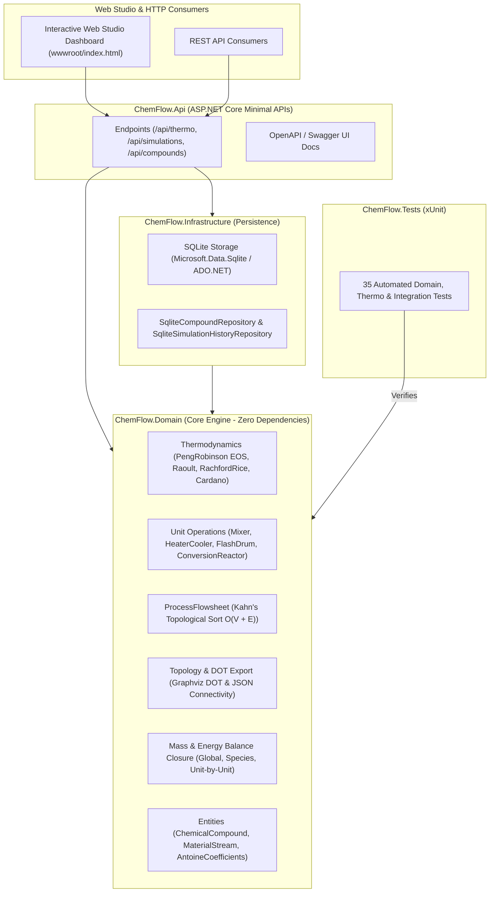

# ChemFlow.NET

[](https://github.com/yancsalmeida/ChemFlow.NET/actions/workflows/ci.yml)
[](https://dotnet.microsoft.com/)
[-00599C.svg)](#thermodynamics--process-physics)
[](https://github.com/yancsalmeida/ReactorCore.C)
[-2ea44f.svg)](#automated-testing)
[](docker-compose.yml)
[](LICENSE)

An enterprise-grade **Modular Steady-State Chemical Process & Thermodynamic Simulation Engine** built with **C# 12** and **.NET 8** following strict **Clean Architecture** principles.

It models multi-component non-ideal vapor-liquid equilibrium (Peng-Robinson EOS and Raoult's Law), rigorous mass and enthalpy balances across unit operations, directed acyclic graph (DAG) process flowsheet execution with Graphviz/DOT topology export, mass/energy balance closure validation ($\Delta m < 10^{-5}$, $\Delta H < 10^{-4}$), and relational persistence in **SQLite**.


---

## Architecture (Clean Architecture & DAG Execution)

The solution is partitioned into modular layers adhering to strict **Dependency Inversion** and **Separation of Concerns**:



### Project Structure

```text
ChemFlow.NET/
├── src/
│   ├── ChemFlow.Domain/           # Pure domain models, thermodynamics, unit operations, DAG engine & balance reports
│   ├── ChemFlow.Infrastructure/   # Relational SQLite persistence with schema migration (ADO.NET / Microsoft.Data.Sqlite)
│   └── ChemFlow.Api/              # ASP.NET Core Minimal API endpoints, topology/report queries & OpenAPI/Swagger
└── tests/
    └── ChemFlow.Tests/            # Automated unit & integration test suite (xUnit & WebApplicationFactory)
```

---

## Thermodynamics & Process Physics

### 1. Peng-Robinson Cubic Equation of State (PR-EOS 1976)
For non-ideal, high-pressure, and hydrocarbon phase equilibria, `PengRobinsonThermodynamicPackage` evaluates real-fluid behavior:
$$P = \frac{RT}{v - b} - \frac{a(T)}{v(v + b) + b(v - b)}$$

- **Cardano Analytical Cubic Solver:** Solves the cubic compressibility equation $Z^3 - (1-B)Z^2 + (A - 3B^2 - 2B)Z - (AB - B^2 - B^3) = 0$, discriminating between physical liquid ($Z_L$) and vapor ($Z_V$) roots.
- **Fugacity Coefficients ($\phi_i^L, \phi_i^V$):** Evaluates non-ideal component fugacities using van der Waals mixing rules:
  $$\ln \phi_i = \frac{b_i}{b}(Z - 1) - \ln(Z - B) - \frac{A}{2\sqrt{2}B} \left( \frac{2 \sum_j z_j a_{ij}}{a} - \frac{b_i}{b} \right) \ln\left( \frac{Z + (1+\sqrt{2})B}{Z + (1-\sqrt{2})B} \right)$$
- **Equilibrium Ratios:** Computes rigorous non-ideal $K$-values ($K_i = \phi_i^L / \phi_i^V$) converged via damped successive substitution.
- **Enthalpy Departure Functions:** Computes real fluid thermal enthalpy: $H(T, P) = H^{\text{ideal}}(T) + H^{\text{dep}}(T, P)$.

### 2. Antoine Vapor Pressure & Raoult's Law (Ideal VLE)
Saturation pressure $P_i^{\text{sat}}(T)$ is evaluated using NIST/DIPPR-style Antoine equations:
$$\log_{10}(P_i^{\text{sat}}) = A_i - \frac{B_i}{T + C_i}$$
Equilibrium $K$-values follow Raoult's Law ($K_i = P_i^{\text{sat}}(T)/P$), establishing fast analytical Bubble Point ($P_{\text{bubble}}, T_{\text{bubble}}$) and Dew Point ($P_{\text{dew}}, T_{\text{dew}}$) solvers.

### 3. Safeguarded Rachford-Rice Isothermal Flash
The isothermal vapor fraction $\beta = V / F$ is determined by solving the objective function:
$$f(\beta) = \sum_{i=1}^{N} \frac{z_i (K_i - 1)}{1 + \beta (K_i - 1)} = 0$$
using a safeguarded Newton-Raphson solver with automatic fallback to bisection root-finding upon boundary excursion. Subcooled liquid ($f(0) \le 0 \implies \beta = 0$) and superheated vapor ($f(1) \ge 0 \implies \beta = 1$) conditions are resolved analytically.

### 4. Unit Operations & Directed Acyclic Graph (DAG) Flowsheets
- **`MaterialStream`**: Tracks molar and mass flow rates ($\dot{m}$ in $\text{kg/s}$), temperature, pressure, mole fractions, phase state, vapor fraction $\beta$, and specific/total enthalpy.
- **`Mixer`**: Adiabatic multi-stream mixing with rigorous component mass conservation and enthalpy balance root-finding for outlet temperature.
- **`HeaterCooler`**: Sensible and phase-change thermal duty ($\dot{Q}$ in $\text{kW}$) calculation for target temperatures and pressures.
- **`FlashDrum`**: Isothermal/isobaric vapor-liquid phase separator.
- **`Splitter`**: Stream divider partitioning a single inlet into multiple outlets according to fractional splits ($\sum \alpha_k = 1.0$), preserving $(T, P, z_i)$.
- **`ConversionReactor`**: Stoichiometric reactor with limiting-reactant validation, fractional conversion, and heat of reaction ($\Delta H_{\text{rxn}}^\circ$) energy balance.
- **`ContinuousStirredTankReactor`**: Dynamic CSTR unit operation with non-linear Arrhenius kinetics and jacket heat exchange ($UA(T - T_c)$), integrated via 4th-Order Runge-Kutta (RK4) powered natively by [**`ReactorCore.C`**](https://github.com/yancsalmeida/ReactorCore.C) (`libreactorcore.so`) through C-ABI P/Invoke.
- **`ProcessFlowsheet`**: Solves the execution sequence using **Kahn's Topological Sort Algorithm** ($O(V + E)$). Supports closed-loop recycles via **Tear Stream Cutting** and **Wegstein Bounded Secant Convergence Acceleration** ($q \in [-5.0, 0.0]$) with automatic feedback cycle identification.
- **Flowsheet Topology & Graphviz DOT (`ToDot()`):** Automatically compiles the process graph into Graphviz DOT syntax and JSON node/edge schemas for visualization, rendering tear/recycle loops with dashed purple edges.
- **Mass & Energy Balance Closure (`GenerateBalanceReport()`):** Verifies global conservation across plant boundary feeds and products ($\Delta m / m < 10^{-5}$, $\Delta H / H < 5 \times 10^{-4}$), component species conservation, and individual unit operation energy balance closure.

---

## REST API Specification

| Method | Endpoint | Description |
| :--- | :--- | :--- |
| `GET` | `/api/compounds` | Query registered chemical compounds and Antoine coefficients |
| `GET` | `/api/compounds/{id}` | Retrieve specific compound physical properties |
| `GET` | `/api/thermo/models` | List available thermodynamic packages (`Peng-Robinson` vs `Raoult`) |
| `POST` | `/api/thermo/flash` | Solve isothermal $(T, P)$ flash with selected thermodynamic package |
| `POST` | `/api/thermo/txy` | Generate binary $T\text{-}x\text{-}y$ phase equilibrium isobaric curves |
| `POST` | `/api/simulations/benchmark` | Execute and persist flash separation flowsheet (`Mixer` $\rightarrow$ `Heater` $\rightarrow$ `FlashDrum`) |
| `POST` | `/api/simulations/recycle` | Solve closed-loop recycle flowsheet (`Mixer` $\rightarrow$ `FlashDrum` $\rightarrow$ `Splitter` $\rightarrow$ `Mixer`) with Wegstein acceleration |
| `GET` | `/api/simulations` | Retrieve historical simulation runs from SQLite |
| `GET` | `/api/simulations/{id}` | Retrieve detailed stream results for a simulation run |
| `GET` | `/api/simulations/{id}/topology` | Export flowsheet graph topology (JSON or Graphviz DOT via `?format=dot`) |
| `GET` | `/api/simulations/{id}/report` | Retrieve mass and energy balance closure report (closure errors and conservation metrics) |

---

## Quickstart

### 1. Run via Docker Compose (Recommended)

Requires [Docker](https://docs.docker.com/get-docker/):

```bash
docker compose up -d --build
```

- **Interactive Web Studio:** [http://localhost:5080](http://localhost:5080)
- **OpenAPI / Swagger UI:** [http://localhost:5080/swagger](http://localhost:5080/swagger)

### 2. Run Locally via .NET CLI

Requires [.NET 8.0 SDK](https://dotnet.microsoft.com/download/dotnet/8.0):

```bash
# Clone the repository
git clone https://github.com/yancsalmeida/ChemFlow.NET.git
cd ChemFlow.NET

# Restore and Build
dotnet build ChemFlow.sln

# Run API server
dotnet run --project src/ChemFlow.Api
```

---

## Automated Testing

Execute the comprehensive xUnit test suite:

```bash
dotnet test ChemFlow.sln
```

```text
Passed! - Failed: 0, Passed: 50, Skipped: 0, Total: 50, Duration: 698 ms
```

---

## Author

**Yan Almeida**
- LinkedIn: [linkedin.com/in/yancsa](https://www.linkedin.com/in/yancsa/)
- GitHub: [github.com/yancsalmeida](https://github.com/yancsalmeida)
